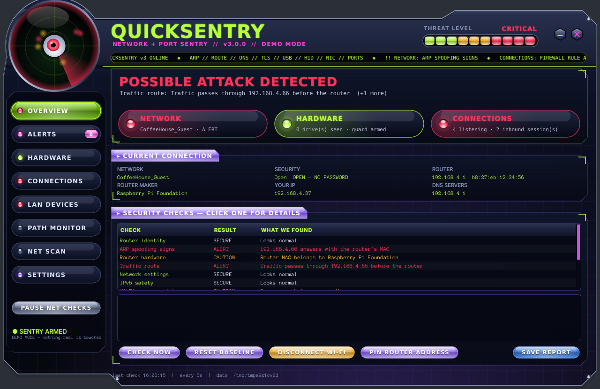
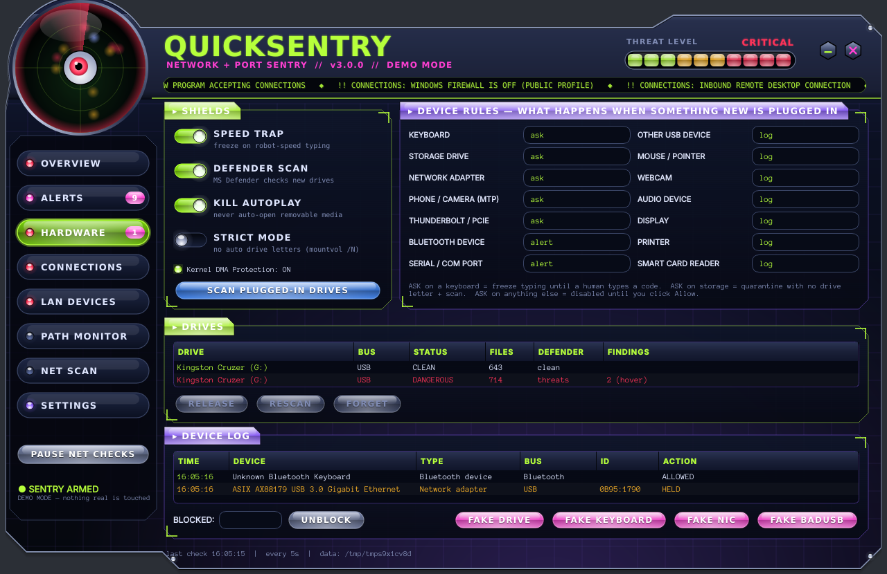
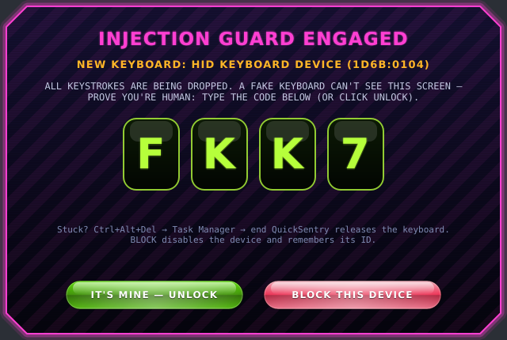
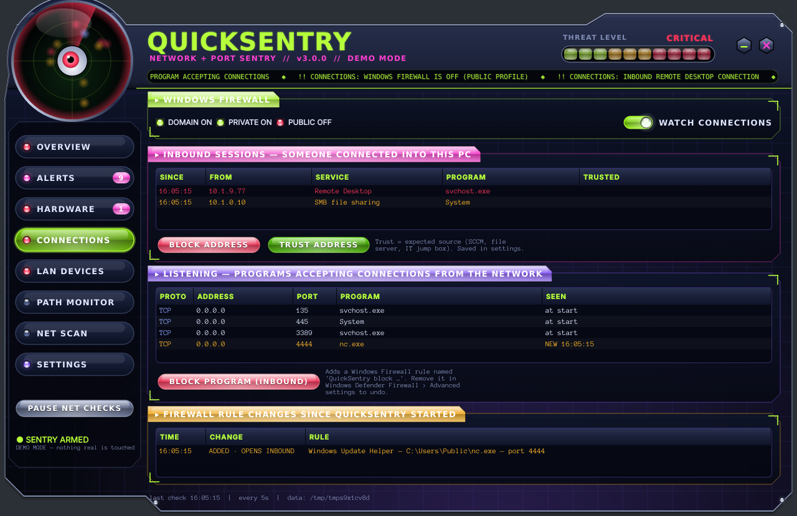

# QuickSentry

A Windows security sentry that watches three things at once:

- **The network you're on:** man-in-the-middle attacks, ARP spoofing, evil-twin Wi-Fi, rogue DHCP/DNS, HTTPS interception.
- **Hardware you plug in:** USB sticks, SD cards, fake keyboards (Rubber Ducky / O.MG), USB network adapters, phones, Thunderbolt docks, Bluetooth.
- **Connections into the PC:** new listening programs, inbound RDP/SMB/WinRM sessions, firewall rules being added or the firewall being turned off.

It also includes a path monitor and a subnet scanner for investigating networks you manage.



> **Detection first, then blocking where it's safe.** On public Wi-Fi your traffic is actually protected by a **VPN** and HTTPS. QuickSentry tells you when something is wrong, and can hold, block or quarantine hardware and inbound traffic.

---

## What's new in v3

- **Hardware guard** (merged from the Drive Defender prototype): one gate for every newly connected device.
- **Connection watch:** listeners, inbound sessions and firewall changes.
- **A new interface** (Qt), with a system tray icon, alert toasts and a radar.
- **Requires administrator.** Blocking devices, freezing a fake keyboard, quarantining drives and adding firewall rules all need admin. Running elevated also lets QuickSentry protect its own data (see *Data and privacy*).
- **Portable mode has been removed.** You can still run the exe from a flash drive, but data now goes to `C:\ProgramData\QuickSentry`. Data from v2 (`%APPDATA%\QuickSentry` or a `QuickSentry-data` folder) is copied over automatically on first run.

---

## Quick start

1. Download **`QuickSentry-Setup-<version>.exe`** from the [Releases](../../releases) page and run it.
   - It installs to `C:\Program Files\QuickSentry` and adds a Start menu entry.
   - The **"Start QuickSentry when I sign in"** option (on by default) starts it in the tray at every sign-in without a UAC prompt. It uses a scheduled task with highest privileges.
   - Uninstall from *Settings → Apps*. It releases any quarantined drives, turns automatic drive letters back on, and asks whether to keep your settings and logs.
2. Prefer no install? Download plain **`QuickSentry.exe`** instead and run it. It asks for admin each time.
3. Watch the **THREAT LEVEL** tube and the three status pods (Network / Hardware / Connections).

| Threat level | Meaning | What to do |
|---|---|---|
| 🟢 **LOW** | Everything checks out. | Nothing. |
| 🟡 **ELEVATED** | Something is unusual but not clearly an attack. | Read the yellow items. |
| 🔴 **CRITICAL** | A strong sign of attack, a frozen keyboard, or a dangerous drive. | Stop sensitive activity and read the red items. |

Only one copy runs at a time. Starting it again just tells you it's already in the tray.

To preview the interface without admin rights or touching anything, run `QuickSentry.exe --demo` (this also works on Linux/macOS from source).

Windows may show a SmartScreen warning because the exe isn't code-signed. Click **More info → Run anyway**, or build it yourself.

---

## Network checks

| Check | What it catches |
|---|---|
| **Router identity** | The router's hardware (MAC) address changing while you're connected. This is the classic sign of ARP spoofing. |
| **ARP spoofing signs** | Another device answering with the router's MAC. |
| **Router hardware** | A "router" whose MAC belongs to a laptop or phone maker, a VM, a Raspberry Pi, known hacking hardware, or a randomized MAC. |
| **Traffic route** | Whether your traffic passes through another local device before the router (TTL=1 probe). |
| **Network settings** | The router, DHCP server or DNS servers changing without a reconnect (rogue DHCP). |
| **IPv6 safety** | Rogue IPv6 routers/DNS servers, including the mitm6 pattern. |
| **Wi-Fi access point** | Evil-twin hotspots, open networks, and suspicious access point MACs. |
| **Compared to last visit** | A different router or lost security compared with your last visit. |
| **Internet / sign-in page** | Captive portals (HTTPS/DNS checks pause until you sign in). |
| **HTTPS encryption** | Certificates for major sites issued by a non-public authority (traffic being decrypted). |
| **Website lookups (DNS)** | Wrong answers for names whose correct addresses never change. |

**Response buttons:** Disconnect Wi-Fi, Pin router address (static ARP entry), Reset baseline, Save report.

---

## Hardware guard



Every newly connected device is matched to a category, and each category has a rule you can change on the **Hardware** page:

| Rule | Effect |
|---|---|
| `log` | Allowed quietly and recorded in the device log. |
| `alert` | Allowed, with a warning. |
| `ask` | Held until you decide (see below). |
| `block` | Disabled immediately. |

What **ask** means for each type:

- **Keyboard** (default `ask`): all typing freezes until a human types a random code shown on screen, or clicks Unlock. A Rubber Ducky can't see the screen, so it can't type the code. The code also has to be typed at human speed.
- **Storage** (default `ask`): the drive loses its drive letter immediately and is mounted into a locked quarantine folder. It's scanned with heuristics (disguised .exe files, malicious shortcuts, autorun.inf, macro documents, the USB-worm hidden-folder trick), optional YARA rules (`rules/`) and Microsoft Defender. Then you choose **Release**.
- **Network adapter, phone/MTP, Thunderbolt/PCIe** (default `ask`): the device is disabled and a pop-up asks **Allow / Always / Block**.
- **Bluetooth, serial** (default `alert`); **mouse, webcam, audio, display, printer, smart card, other USB** (default `log`).

It also does the following:

- **BadUSB detection:** functions that arrive from the same physical device are grouped together. A "flash drive" or "network adapter" that is also a keyboard raises a red alert.
- **Speed trap:** robot-speed typing from *any* keyboard freezes input.
- **Kernel DMA Protection check:** it warns if the protection against Thunderbolt/PCIe memory attacks is off.
- **Optional hardening:** "Kill AutoPlay" sets `NoDriveTypeAutoRun = 0xFF`. "Strict mode" (`mountvol /N`) stops new volumes from getting automatic drive letters, and is undone when QuickSentry exits.
- **Blocking:** blocked devices are remembered by VID:PID and disabled on sight if plugged in again.

If the keyboard is ever stuck, **Ctrl+Alt+Del → Task Manager → end QuickSentry** releases it.



---

## Connection watch



- **Listening:** every program accepting connections from the network. Programs that start listening after launch are flagged. **Block program** adds an inbound firewall rule.
- **Inbound sessions:** someone connected *into* this PC. Remote-control protocols (RDP, WinRM, SSH, VNC, TeamViewer, AnyDesk) raise a red alert, and SMB/RPC raises a yellow one. **Trust** marks expected sources (SCCM, file servers, IT jump boxes). **Block address** adds an inbound firewall rule.
- **Firewall:** it alerts when any profile (Domain/Private/Public) is turned off, including when Group Policy turns it off, and when a new rule *allows* inbound traffic.

Firewall rules QuickSentry adds are named `QuickSentry block …`. Remove them in *Windows Defender Firewall → Advanced settings* to undo.

---

## Path Monitor (for networks you manage)

Repeatedly traces the route from this machine to one or more targets, for example a server on the other side of campus.

- It learns the normal path over the first 3 runs. Load-balanced links that alternate between hops are learned as normal.
- After that, it alerts on a **new device in the path**, a **changed path length**, **latency jumps**, **packet loss**, the **connection going down**, and **traffic passing through a local device before the router**.
- **Accept current path** marks a legitimate change as the new normal.

**Limit:** a fully transparent inline device (a bridge or tap) does not show up in a traceroute.

## Network Scan

Sweeps an IP range (`192.168.1.0/24`, `10.1.2.10-10.1.2.80`, `10.1.2.10-80`; max 1024 addresses). It flags duplicate MACs, randomized MACs, VMs, Raspberry Pis and known hacking hardware. Results export to CSV. **Only scan networks you're authorized to scan.**

---

## Data and privacy

- **Location:** everything is stored in `C:\ProgramData\QuickSentry` (settings, remembered networks, logs, reports and the temporary drive-quarantine folder). The folder is restricted to **SYSTEM and Administrators**, so a standard user, or malware running as one, can't edit the baseline or erase the logs.
- **Outbound traffic:** nothing is sent anywhere except the small test requests the network checks make (`www.msftconnecttest.com`, `www.google.com`, `www.microsoft.com`, `www.cloudflare.com`, plus DNS lookups for `one.one.one.one`, `dns.google` and one random made-up name).
- **Remembered networks:** clear them under **Settings → Forget remembered networks**.

---

## Building it yourself

Requires Python 3.10+ on PATH. The installer also needs Inno Setup 6 (`winget install JRSoftware.InnoSetup`).

| Script | Output |
|---|---|
| `build_exe.bat` | Runs the tests and builds `dist\QuickSentry.exe` (one file, asks for admin). |
| `build_installer.bat` | Does the above, then builds `dist\QuickSentry-Setup-<version>.exe` from `installer\QuickSentry.iss`. |

GitHub Actions (`.github/workflows/build.yml`) runs the tests and builds both files on every push. Pushing a tag such as `v3.0.0` also publishes a Release with both attached. The tag must match `__version__` in `quicksentry/__init__.py`.

To run from source, use `python quicksentry_gui.py`. Useful flags:

| Flag | What it does |
|---|---|
| `--demo` | UI preview, touches nothing, no admin needed |
| `--tray` | Start hidden in the tray |
| `--diagnostics` | Write a diagnostics report |
| `--cleanup` | Release quarantined drives and undo Strict mode |

---

## First-run test checklist (use a test machine)

1. `QuickSentry.exe --demo`: click the **Fake drive / Fake keyboard / Fake NIC / Fake BadUSB** buttons on the Hardware page.
2. **Clean stick:** it should be *quarantined → scanning → clean* with no drive letter until you click Release.
3. **EICAR test file** (eicar.org) on a stick: Defender should report `threats` and the drive should go DANGEROUS. If Defender reports `clean`, it isn't following the quarantine mount point on your build. Open an issue.
4. **USB keyboard:** typing freezes. Type the code and it unlocks.
5. **USB Ethernet adapter:** it's held. Allow should bring it back.
6. Confirm **Ctrl+Alt+Del → Task Manager** releases a frozen keyboard.

---

## Limitations

- **There's a letter race on drives.** Windows assigns a drive letter before QuickSentry can pull it (about a second). Kill AutoPlay plus Strict mode closes most of that window.
- **The speed trap only catches fast typing.** A Ducky scripted to type at human speed won't trip it. The new-keyboard freeze is the real defense. The first ~12 robot keystrokes get through before the trap trips.
- **VID:PID can be spoofed.** Blocking by VID:PID is a convenience, so keyboards can never be "always allowed".
- **Thunderbolt/PCIe memory attacks can happen the instant a device connects.** Only Kernel DMA Protection (BIOS/UEFI) actually stops them. QuickSentry can only warn and disable the device afterwards.
- **Network checks are polling-based** (default 5 s), and the first visit to a network has no history.
- **Legitimate changes trigger alerts too.** Examples: a router replacement, an installer adding firewall rules, or SCCM connecting over SMB. Every alert explains the normal explanations.
- **It's user-mode software.** Firmware attacks, kernel exploits and USB-killer hardware are out of scope. On managed fleets, Intune/GPO device-installation restrictions remain the enterprise-grade layer.
- **Windows only.** `--demo` runs anywhere, and `tools/arp_monitor_linux.py` is a minimal Linux command-line ARP monitor.
- **English Windows is expected** for the Wi-Fi and `ipconfig` readers. The ARP, route, ping, device and connection checks use the Windows API and work in any language.

## Troubleshooting

- **"Windows is blocking Wi-Fi details."** Turn on **Settings → Privacy & security → Location**, plus **Let desktop apps access your location**.
- **Something doesn't look right.** Use **Settings → Run diagnostics**, or `QuickSentry.exe --diagnostics`.
- **Constant yellow "HTTPS inspection" on a work or school network.** This is expected where a web filter inspects HTTPS. It drops to Info on later visits.

## Project layout

```
quicksentry_gui.py        Entry point
build_exe.bat             Build dist\QuickSentry.exe
build_installer.bat       Build dist\QuickSentry-Setup-<version>.exe
installer/                Inno Setup script + sign-in autostart helper
quicksentry/
  app.py                  Startup: admin check, --demo, --diagnostics
  engine.py               Network detection logic (all checks)
  sysinfo.py, winapi.py   Snapshot of ipconfig/netsh/neighbor table; Windows API calls
  webchecks.py            Sign-in page, HTTPS, DNS checks
  pathmon.py, scanner.py  Path monitor; subnet scan
  oui.py, oui_data.py     Offline MAC vendor database (IEEE)
  actions.py, storage.py  Disconnect/pin/reports/diagnostics; settings and data folder
  guard/
    hardware.py           Hardware guard (device rules, drive quarantine, BadUSB grouping)
    win32dev.py           Device notifications, classification, enable/disable, DMA status
    kbguard.py            Keyboard freeze, unlock code, speed trap
    filescan.py           Drive scanning: heuristics + Defender + YARA
    netwatch.py           Listeners, inbound sessions, firewall changes
  ui/                     Qt interface (theme, widgets, pages, popups, workers)
rules/                    Drop-in YARA rules
tools/                    Minimal command-line ARP monitors (Linux / Windows)
tests/                    Tests (run on any OS)
```

Run tests: `python tests/test_parsers.py`, `python tests/test_engine.py`, `python tests/test_path.py`, `python tests/test_guard.py`.

## Acknowledgements

Inspired by classic ARP monitoring tools such as [arpwatch](https://en.wikipedia.org/wiki/Arpwatch) (LBNL) and XArp. QuickSentry was previously named "ARP Watch".

## License

[MIT](LICENSE). MAC vendor data comes from the IEEE OUI registry, via the netaddr project.
